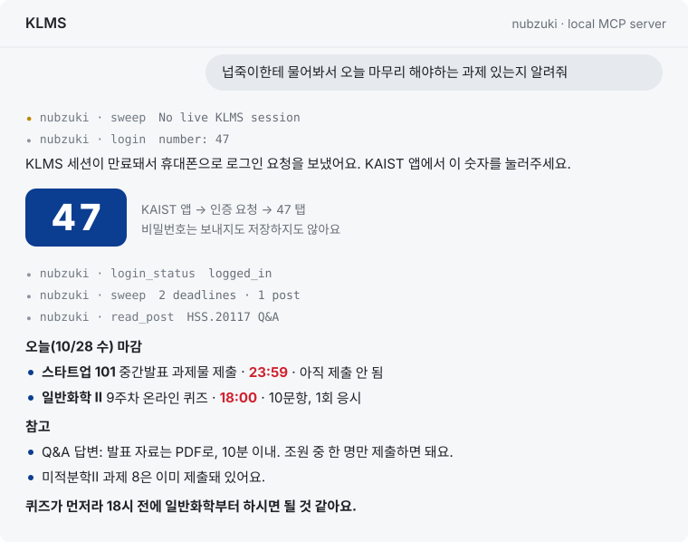
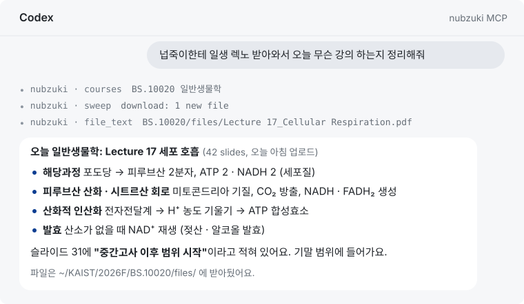
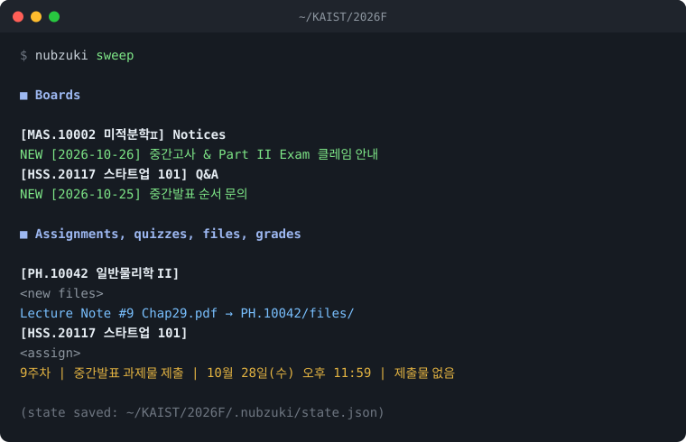

<p align="center">
  <picture>
    <source media="(prefers-color-scheme: dark)" srcset="assets/logo-dark.svg">
    
  </picture>
</p>

<p align="center">Lets Claude, Codex, Gemini CLI or Cursor read your KLMS.<br>
Ask what's due today and it actually goes and checks.</p>

<p align="center">
  <a href="https://github.com/Koooon-and-meemee/nubzuki/actions/workflows/test.yml"></a>
</p>

<p align="center"></p>

## Install

```sh
pipx install git+https://github.com/Koooon-and-meemee/nubzuki

nubzuki login --id <your KAIST ID>   # approve it in the KAIST app
nubzuki mcp install
```

`mcp install` adds nubzuki to whatever you have installed out of Claude (the app and Claude Code), Codex, Gemini CLI and Cursor.
Restart the app and ask something like

```
넙죽이한테 물어봐서 오늘 마무리 해야하는 과제 있는지 알려줘
```

You don't have to keep anything running. The app starts nubzuki when it needs it.
When your KLMS session runs out, the AI sends a login request to your phone and tells you which number to tap.
The first time, it makes a folder per course under `~/KAIST/2026F/` (`nubzuki init --root DIR` to put them somewhere else).

You need the KAIST login app registered for your account (sso.kaist.ac.kr → 로그인 앱 등록).
If you don't have pipx: `brew install pipx` on a Mac, `pip install --user pipx` otherwise.
pipx installs straight from GitHub, so you also need git (`xcode-select --install` on a Mac, [git-scm.com](https://git-scm.com) otherwise).

### Updating

```sh
pipx reinstall nubzuki
```

This pulls the latest version from GitHub. Restart the app afterwards so it picks up the new tools.

### If you use ChatGPT

The ChatGPT app can't connect to an MCP server running on your own computer, and nubzuki deliberately only runs on yours.
Use [Codex](https://developers.openai.com/codex) instead. You sign in with your ChatGPT account, and `nubzuki mcp install` sets it up like the others.

## Things you can ask

<p align="center"></p>

- 넙죽이한테 일생 렉노 받아와서 오늘 무슨 강의 하는지 정리해줘
- 이번 주 마감 전부 날짜순으로 알려줘
- 미적 최신 공지 읽고 클레임 언제 어디서 하는지 알려줘
- 새로 올라온 파일 다 받아서 요약해줘
- 미적 성적표 전체 보여주고 Part II 합계 계산해줘
- 포탈에 새로 올라온 장학·근로 공지 중에 나한테 해당되는 거 있어?

Course nicknames like 일생 or 미적 are fine. The AI matches them against your course list.
It reads post bodies and attachments too, because that's usually where the room number or exam scope is.

## On your phone (Claude only)

Leave your Mac on and run

```sh
nubzuki remote
```

then open the Claude app on your phone, go to Code, and pick the KLMS session.
Everything still runs on the Mac and the phone just shows the chat.
The KAIST login request comes to the same phone, so logging in takes two taps.

This is Claude Code's Remote Control (`claude remote-control`) started in your semester folder,
with nubzuki's tools allowed so you don't have to approve every call from your phone.

## In a terminal

<p align="center"></p>

`nubzuki sweep` shows what changed since the last time you ran it: new posts on Notices, Q&A and the free board,
changed rows in the assignment and quiz tables, newly uploaded course files, new grades
and new notices on the KAIST portal (portal.kaist.ac.kr).
`--download` also saves the new files into each course's `files/` folder.
The first run saves a baseline and only shows posts from the last 7 days.
A full sweep takes a minute or so, because KLMS serves about one page a second.

The phone login also opens a portal session, so portal notices need no extra step.
If only the portal session has run out, `sweep` still checks KLMS and tells you to log in again.

You never type a course or board ID. nubzuki reads your courses off the dashboard.
When KLMS moves on to a new semester, `sweep` tells you, and `nubzuki init` switches over.

## Privacy

nubzuki runs on your computer and only talks to `klms.kaist.ac.kr`, `portal.kaist.ac.kr` and `sso.kaist.ac.kr`.
There's no server and no analytics.
It never sees your password. Login goes through KAIST's own easy login, so all you do is tap a number on your phone.
The session cookies are stored in `~/.config/nubzuki/cookie` and `portal_cookie` (mode 600).
nubzuki won't send either to any other host, even if a post links somewhere else. The MCP tools can only read and write inside your semester folder.

Q&A and free-board posts are written by other students. Through the MCP tools their names are masked (홍O동),
and their bodies aren't handed to the AI at all unless you run `nubzuki privacy --student-posts on`.
Titles still show up, so you know something was asked.

`.nubzuki/state.json` in the semester folder has your grades in it. Don't commit it or share it.

This is an unofficial tool and has nothing to do with KAIST. Use it on your own account.
It sends one request at a time. Please don't run it in a loop.

## Reference

<details>
<summary>Commands</summary>

```sh
nubzuki login [--id ID]                            # phone login (ID is remembered)
nubzuki login --cookie                             # paste a MoodleSession cookie instead
nubzuki init [--root DIR]                          # semester folder + one folder per course
nubzuki courses [--json]                           # course IDs and board IDs

nubzuki sweep                                      # what changed since the last run
nubzuki sweep --download                           # also download new course files
nubzuki sweep --since 2026-10-01
nubzuki sweep --json

nubzuki read <board> <bwid> [<board> <bwid> ...]   # post body + attachment links
nubzuki read <board> <bwid> --save                 # save to <course>/notices/<bwid>.md
nubzuki grades 미적                                # the whole gradebook, totals included
nubzuki portal [--limit 30]                        # latest KAIST portal notices
nubzuki portal <id>                                # one portal notice with attachment names
nubzuki privacy --student-posts on|off             # let the MCP tools read Q&A and free-board bodies
nubzuki dl <url> [...] --to CS.10001/files         # download attachments
nubzuki text lecture.pdf                           # PDF, PPTX (with speaker notes), DOCX, TXT, MD

nubzuki mcp install [--only codex ...]             # claude-code, claude-app, codex, gemini, cursor
nubzuki remote [--name KLMS]                       # use it from the Claude app on your phone
nubzuki mcp                                        # the MCP server itself; apps start it for you
```

PDFs work out of the box on a Mac. On Linux and Windows `nubzuki text` needs `pdftotext`
(`apt install poppler-utils`, `choco install poppler`).
</details>

<details>
<summary>MCP setup by hand</summary>

`mcp install` writes the full path to `nubzuki` into each app's config, because GUI apps don't see your shell's PATH.
It leaves your other settings alone and keeps the old file as `.bak`.
To do it yourself, get the path from `which nubzuki` and add:

Claude app (`claude_desktop_config.json`), Gemini CLI (`~/.gemini/settings.json`), Cursor (`~/.cursor/mcp.json`):

```json
{ "mcpServers": { "nubzuki": { "command": "/full/path/to/nubzuki", "args": ["mcp"] } } }
```

Codex (`~/.codex/config.toml`):

```toml
[mcp_servers.nubzuki]
command = "/full/path/to/nubzuki"
args = ["mcp"]
```

Claude Code: `claude mcp add nubzuki -s user -- /full/path/to/nubzuki mcp`

Tools: `sweep`, `deadlines`, `posts`, `read_post`, `course_files`, `download`, `file_text`, `list_files`,
`courses`, `init`, `login`, `login_status`.

Agents without MCP can call the CLI directly. Every command prints plain text, and `sweep --json` gives structured output.
For Claude Code there's also a skill in `skills/nubzuki/SKILL.md`.
</details>

<details>
<summary>Logging in</summary>

```
$ nubzuki login --id <your KAIST ID>

  → Open the KAIST app on your phone and tap  47

Waiting for approval (up to 3 minutes)...
Logged in.
```

nubzuki sends only your ID. KAIST pushes a request to the KAIST app and you tap the number shown.
The ID is remembered, so later a login request is sent for you when the session expires (at most once a minute).
KAIST may send a "new device" notice each time, because nubzuki doesn't register itself as a trusted device.

Before asking your phone, nubzuki tries sessions you already have, in this order:

1. `NUBZUKI_COOKIE` environment variable (e.g. `MoodleSession=...`)
2. `~/.config/nubzuki/cookie`, written by `nubzuki login`
3. Chrome, Edge, Brave, Firefox or Safari through `browser_cookie3`, if installed
4. Chrome on macOS, via the "Chrome Safe Storage" Keychain entry (macOS asks once)
5. Firefox on any OS, from the profile's `cookies.sqlite`

On Windows, Chrome and Edge 127+ encrypt cookies so other programs can't read them.
Use phone login, Firefox, or `nubzuki login --cookie` with `MoodleSession` copied from DevTools.
</details>

<details>
<summary>Folder layout</summary>

```
~/KAIST/2026F/
├── .nubzuki/          # course list and sweep state (has your grades)
├── .claude/           # made by `nubzuki remote`
├── CS.10001/
│   ├── files/
│   └── notices/
├── MAS.10002/
└── ...
```

Inside a semester folder nubzuki uses that semester. Anywhere else it uses the one you last ran `init` for.
Semester suffixes are `S` spring, `U` summer, `F` fall and `W` winter.
</details>

<details>
<summary>Why "nothing new" can be trusted</summary>

KLMS answers an expired session with HTTP 200 and a login page, and Moodle answers too many parallel requests
with an "Unable to obtain session lock" page. A naive scraper reads both as "no new posts".
nubzuki checks every page for a logged-in session and stops without touching the saved state if it isn't one,
and it waits and retries on session locks.
</details>

<details>
<summary>Other ways to install</summary>

```sh
pip install git+https://github.com/Koooon-and-meemee/nubzuki
pip install "nubzuki[browser] @ git+https://github.com/Koooon-and-meemee/nubzuki"   # browser_cookie3 support
```

From a clone, if you want to read or change the code. `git pull` is then all it takes to update:

```sh
gh auth login                  # only needed to push; the repo is public
git clone https://github.com/Koooon-and-meemee/nubzuki
cd nubzuki
pipx install --editable .
git pull                       # later, to update
```

Tested on macOS, Linux and Windows with Python 3.9 and 3.13. If KLMS changes its layout and something breaks, open an issue.
</details>

## License

MIT. Named after Nubzuki, KAIST's mascot. Not affiliated with KAIST. The screenshots above use made-up data.
